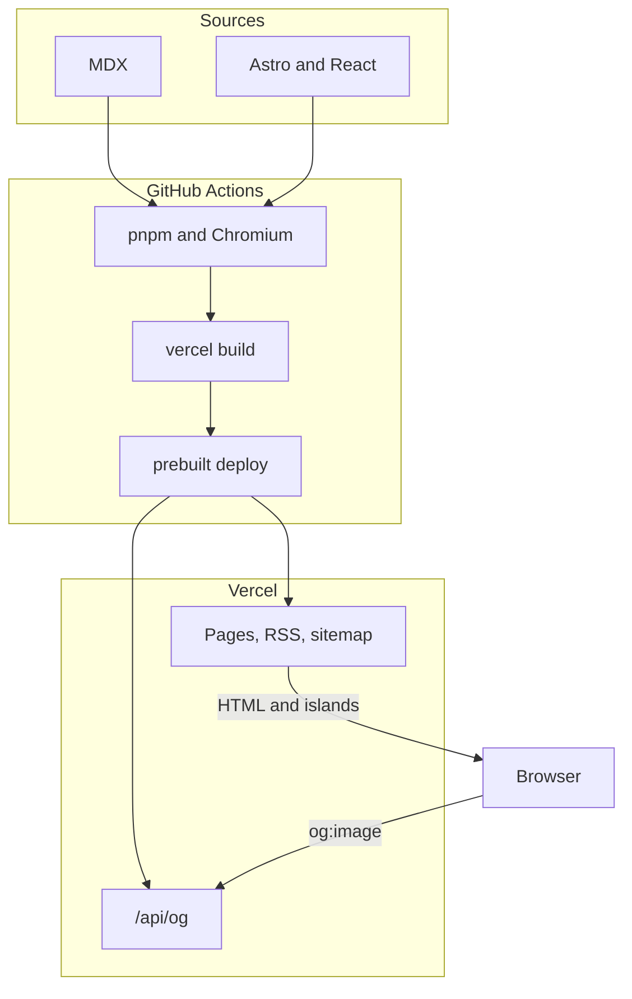

# www.anav.dev

This is my portfolio. It covers projects, skills, certifications, experience, and blogs. Pages are prerendered from MDX at build time. The one dynamic route is `/api/og`, which renders open graph images on request. GitHub Actions builds the site and deploys the prebuilt output to Vercel.



## Technologies used

Astro generates the site through the Vercel adapter. React islands cover navigation, search, tag filters, and code blocks. Tailwind CSS handles styling.

Content lives in MDX collections for blogs, projects, experience, skills, and certs. During the build, Shiki highlights code, rehype-mermaid renders diagrams to inline SVG with Playwright Chromium, and rehype-mathjax renders math. Fuse.js powers client-side search.

`/api/og` uses `@vercel/og` to draw a 1200 by 600 image from the page title and description. Partytown loads Umami off the main thread. GitHub Actions runs on every push with Node 24 and pnpm 10, then deploys to Vercel.

## Local development

`postinstall` downloads Playwright Chromium, which Mermaid needs when you build.

```bash
pnpm install
pnpm dev
```

`pnpm build` runs `astro check` and `astro build`. `pnpm preview` serves that output locally. Production deploys skip those scripts. The workflow runs `vercel pull`, `vercel build --prod`, and `vercel deploy --prebuilt --prod` with `VERCEL_ORG_ID`, `VERCEL_PROJECT_ID`, and `VERCEL_TOKEN`.

## Learning resources

- [Deploy an Astro site to Vercel](https://docs.astro.build/en/guides/deploy/vercel/)
- [Open graph images on Vercel](https://vercel.com/docs/og-image-generation)
- [Mermaid flowchart syntax](https://mermaid.js.org/syntax/flowchart.html)
