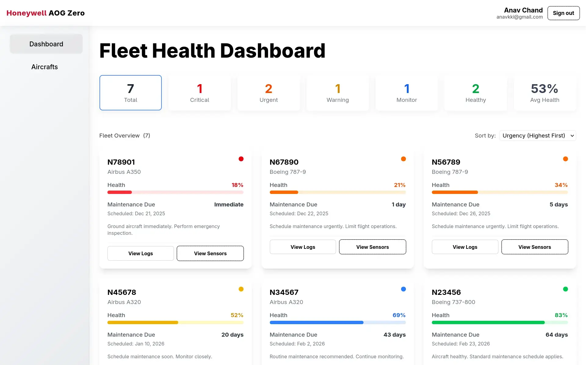
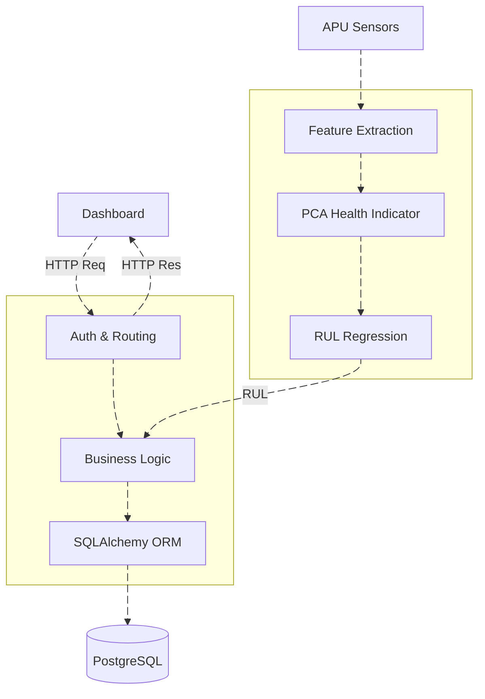

## Project Overview 

---

This is an Aircraft On Ground prevention system that monitors Auxiliary Power Units across a fleet. It was built as our solution for the [Honeywell Aerospace & TCS AI Hackathon](https://www.linkedin.com/posts/aanaav_aihackathon-appliedai-softwarearchitecture-ugcPost-7408422859645059072-H47d) held at the University of the South Pacific.

## Problem Statement 

---

Aircraft On Ground (AOG) events, often caused by component failures, lead to costly delays and disruptions. The [Auxiliary Power Unit](https://www.lot.com/is/en/explore/inspirations/aviation-trivia/apu-on-a-plane) (APU) is a frequent source of these issues, powering key systems when main engines are off. Maintenance is mostly reactive due to limited real-time health monitoring and scarce run-to-failure data. A proactive, data-driven approach that estimates Remaining Useful Life (RUL) early is needed to prevent AOG incidents through timely maintenance.

## Solution Architecture 

---

The system is built around a three-tier architecture that connects the ML pipeline, backend services, and frontend dashboard. The prediction model processes sensor data and generates RUL estimates, which are served through an API and stored in the database. The frontend then uses this data to visualize APU health and maintenance information.

### Frontend 

---

Next.js is used to create a dashboard that allows users to view real-time APU health, browse maintenance logs and manage their fleet. Each type of sensor data is visualized using line charts powered by ReCharts.

### Backend

---

FastAPI exposes a REST API which allows the frontend to connect with the database and prediction model. The schema and queries for the database (PostgreSQL) are handled by SQLAlchemy.

### AI/ML

---

A linear regression in Scikit-learn maps the Health Indicator to remaining useful life. RUL is that indicator's position between the start of life and the end of life, written as a percentage of total life. On the test set the model reached an R2 of 0.97 and an RMSE of 12.76%. The fitted Z-score scaler is saved with the model and applied again at inference, so a live window is scaled the same way as the training data.

### Infrastructure

---

The frontend, backend, and database are containerized using Docker and orchestrated using Docker Compose. The system was deployed on Azure VMs (for the duration of the hackathon) with a CI/CD pipeline using [Dokploy](https://dokploy.com).

## Feature Engineering

---

Each recorded life is smoothed, split into health snapshots, and described with statistics. PCA folds those statistics into one Health Indicator, and that indicator is what the RUL model reads.

### Synthetic Life

---

Labeled run-to-failure data is scarce, so training uses one synthetic life. The six channels are ambient temperature, combustion temperature (EGT), oil temperature, vibration, pressure, and RPM. Each one degrades on a smooth bounded curve with Gaussian noise, and a random failure threshold means each channel fails at a different point in that life.

### Sliding Windows

---

A moving average keeps the slow wear trend and drops high-frequency noise. The signal is then cut into windows. Each window is one health snapshot, long enough for stable statistics and short enough that gradual wear still shows up.

### Statistical Features

---

Fifteen features per sensor makes ninety numbers per window. Means and medians track drift. Standard deviation, RMS, and peak-to-peak track instability. Kurtosis and skewness pick up early faults. Quartiles and scale-free ratios, such as standard deviation over mean, keep a high-magnitude sensor from drowning the others.

### Health Indicator

---

The features are Z-score normalized, then PCA keeps the first principal component as the Health Indicator. That component is the aging trend. It is forced to move in one direction, in line with irreversible wear. Linear regression on this series produces the RUL estimate.

## Project Results

---

Those estimates are what the dashboard uses for fleet health and maintenance timing. The system placed 3rd overall in the Honeywell & TCS AI Hackathon. The linear model reached that accuracy because the Health Indicator was already a clean degradation signal. The next gain is a nonlinear or temporal model on the same features.
